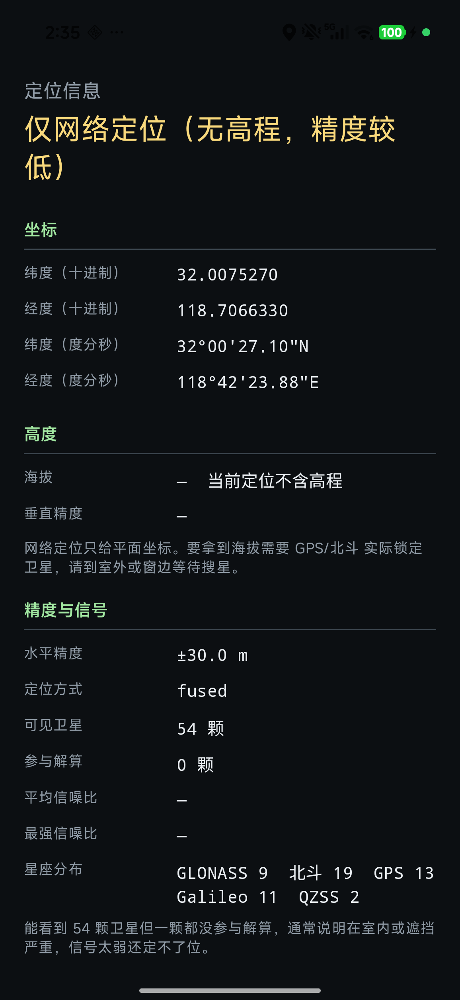
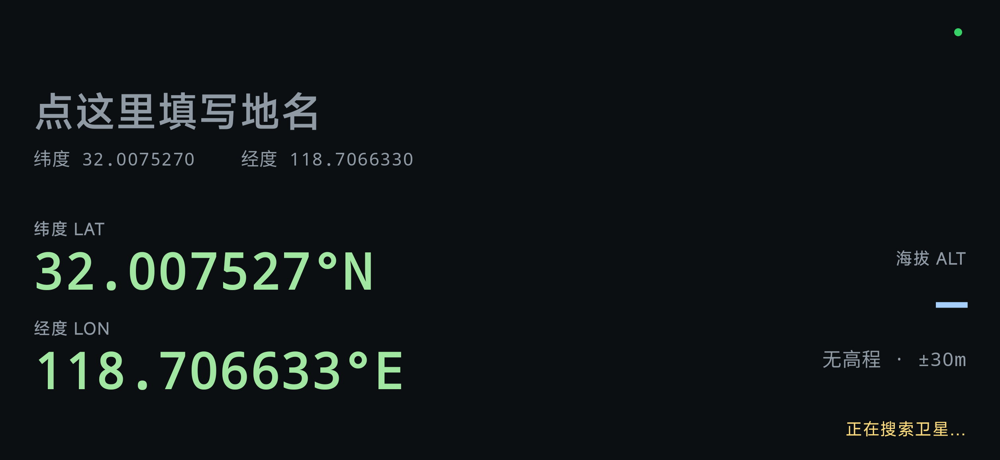

# GPS Show

一个极简的 Android 定位信息查看器。竖屏看完整数据，横屏变成适合拍照打卡的大字号画面。

当前版本 **0.1.0** ｜ [更新日志](CHANGELOG.md) ｜ [下载 APK](https://github.com/XRiver/minimal-gps/releases/latest)

不联网、不上传。除本机保存的打卡地名与最近一次有效定位外，不采集任何数据，
也没有申请网络权限。

## 功能

### 竖屏：完整定位详情

- 坐标：十进制度与度分秒两种写法，带南北/东西半球标记
- 高度：WGS84 椭球面海拔、平均海平面海拔、垂直精度
- 信号：可见卫星数、参与解算数、平均与最强信噪比、各星座分布
- 运动：速度（m/s 与 km/h）、方位角与方位精度
- 时间：定位时刻、数据新鲜度、系统时间
- 状态：活跃定位源、GPS 硬件有无、是否来自模拟位置

### 横屏：打卡视图

超大字号显示地名、经纬度与海拔，并自动隐藏状态栏和导航栏，画面上没有任何控件。
**点击地名即可编辑**，内容保存在本机，下次打开自动带出。适合直接举起手机拍照。

### 没信号时不骗你

室内收不到卫星时，很多应用会显示一个没有高程的坐标，或把 0 当成海拔。GPS Show 的做法是：

- **没有高程就明确显示没有**，不会用 0 冒充
- **精度没收敛就不声称已定位**，而是提示"精度收敛中"
- 如果你曾在室外成功定位过，那次的海拔会作为**历史值**继续显示，并标注取得时间与距今多久，绝不伪装成实时数据

状态文字会在三个档位间递进：`正在搜索卫星…` → `已收到高程，精度收敛中` → `GPS 三维定位已锁定`。

## 截图

| 竖屏详情 | 横屏打卡 |
|---|---|
|  |  |

## 环境要求

- Android 8.0（API 26）及以上
- 构建需要 JDK 17+ 与 Android SDK（compileSdk 36）

## 构建

```bash
./gradlew assembleDebug     # 调试包
./gradlew assembleRelease   # 发布包（需配置签名，见下）
./gradlew testDebugUnitTest # 单元测试
```

若 Gradle 下载 JDK 工具链较慢或卡住，在 `~/.gradle/gradle.properties` 里指定本机 JDK 17：

```properties
gpsshowJdk17Path=D:\\path\\to\\jdk17
```

### 签名

复制 `keystore.properties.example` 为 `keystore.properties` 并填入密钥信息：

```properties
storeFile=keystore/release.jks
storePassword=你的口令
keyAlias=你的别名
keyPassword=你的口令
```

没有这个文件时 `assembleRelease` 仍可构建，只是产出未签名包。

生成密钥库：

```bash
keytool -genkeypair -v -keystore keystore/release.jks \
  -alias gpsshow -keyalg RSA -keysize 4096 -validity 10000 \
  -storepass <口令> -keypass <口令> \
  -dname "CN=GPS Show, O=Example, C=CN"
```

> 以后覆盖安装更新必须使用同一个密钥，否则系统会拒绝安装。

### 安装

```bash
adb install -r -g app/build/outputs/apk/debug/app-debug.apk
```

部分设备（如实测的 Redmi / HyperOS）执行 `adb install` 后需要在手机屏幕上**手动确认**
才算完成，命令会挂起等待。按一次确认按钮即可，不必反复重试——失败的安装会话会把
已装版本一起回滚掉。重装后定位权限需要重新授权。

也可以用 [Android CLI](https://developer.android.com/tools/agents/android-cli)：

```bash
android run     # 编译 + 安装 + 启动
```

## 权限

只申请定位权限（`ACCESS_FINE_LOCATION` / `ACCESS_COARSE_LOCATION`），仅在应用处于前台时使用。
未申请网络、存储、后台定位等任何其他权限。

## 项目结构

```
app/src/main/java/com/example/gpsshow/
├── location/       定位采集、多来源择优、历史值缓存
├── ui/             竖屏详情页、横屏打卡页、地名编辑弹窗
├── format/         坐标与各项数值的格式化
├── settings/       打卡地名持久化
└── theme/          深色主题
```

单元测试位于 `app/src/test/`。

## 致谢

启动图标来自 [Flaticon](https://www.flaticon.com/)，源文件见 `icon-src/`。

## 许可

[MIT](LICENSE)
